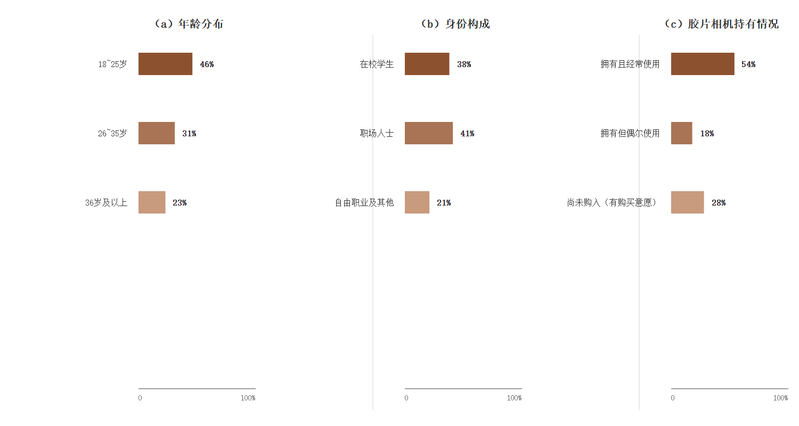
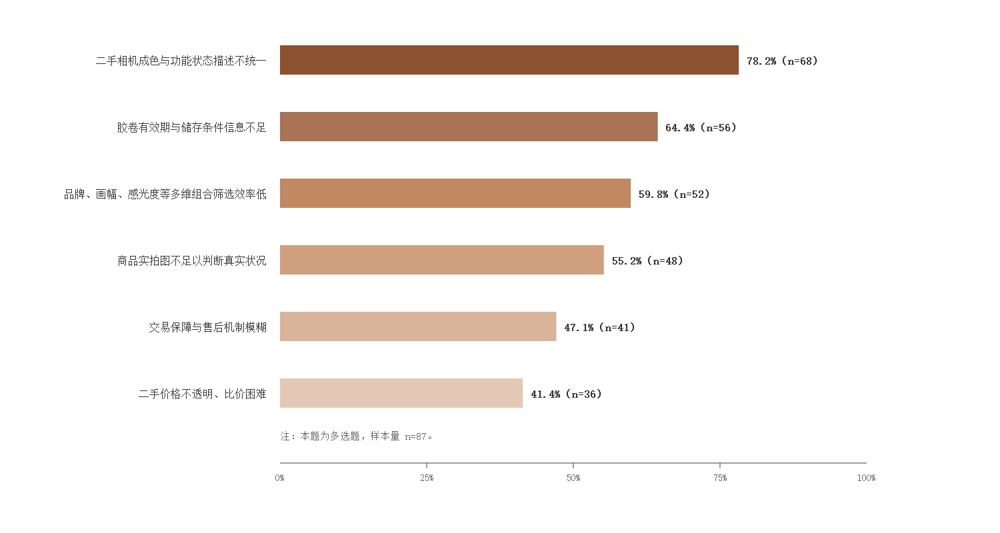
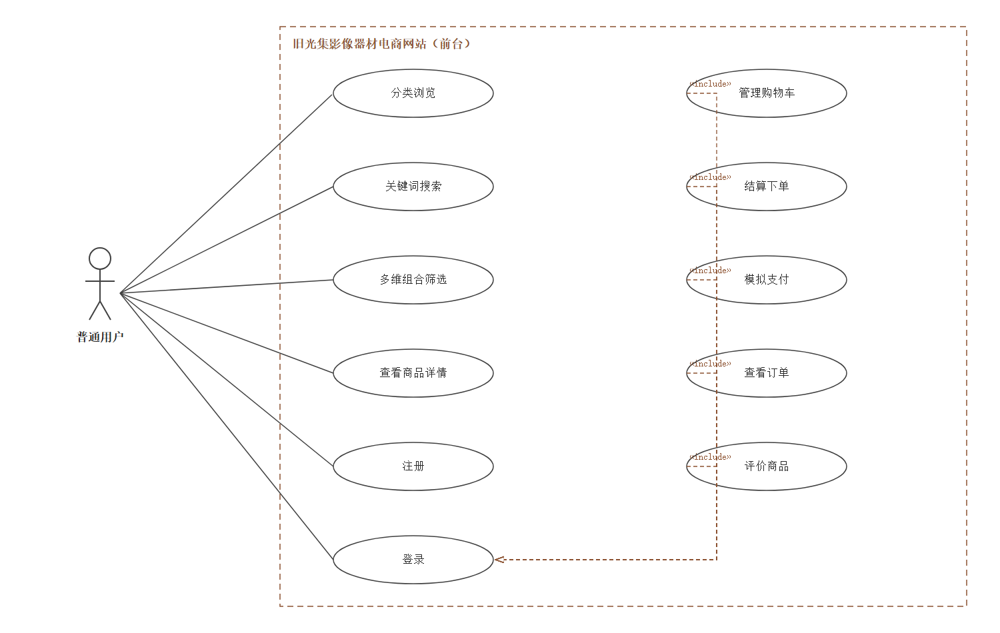
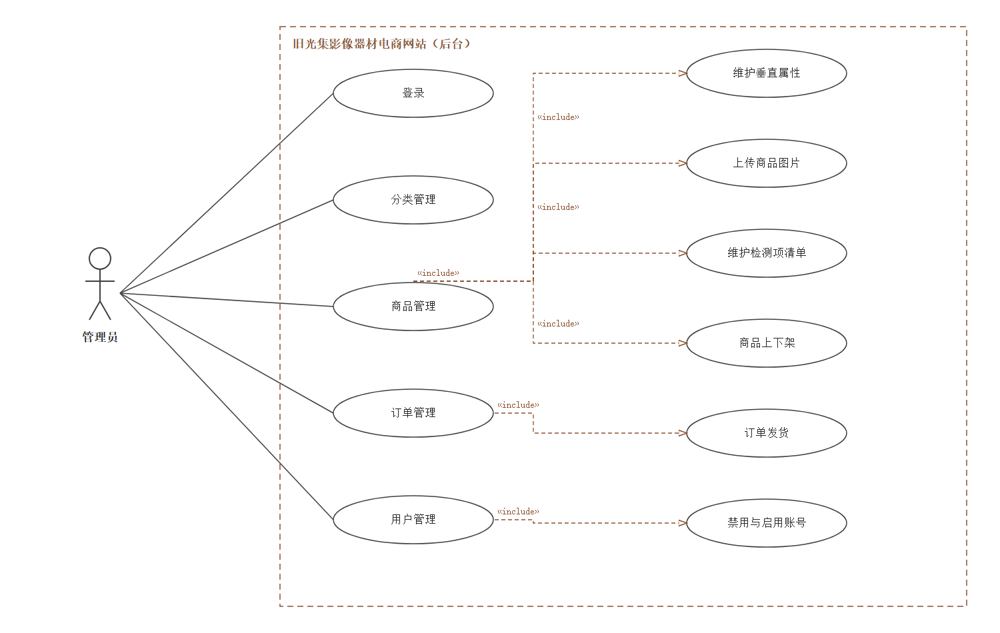
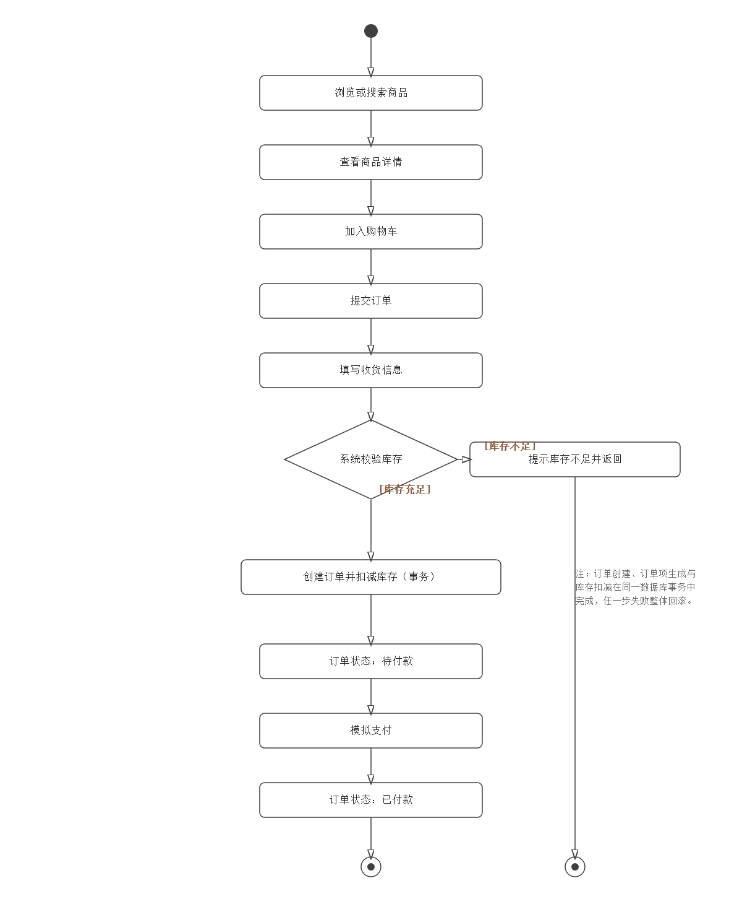
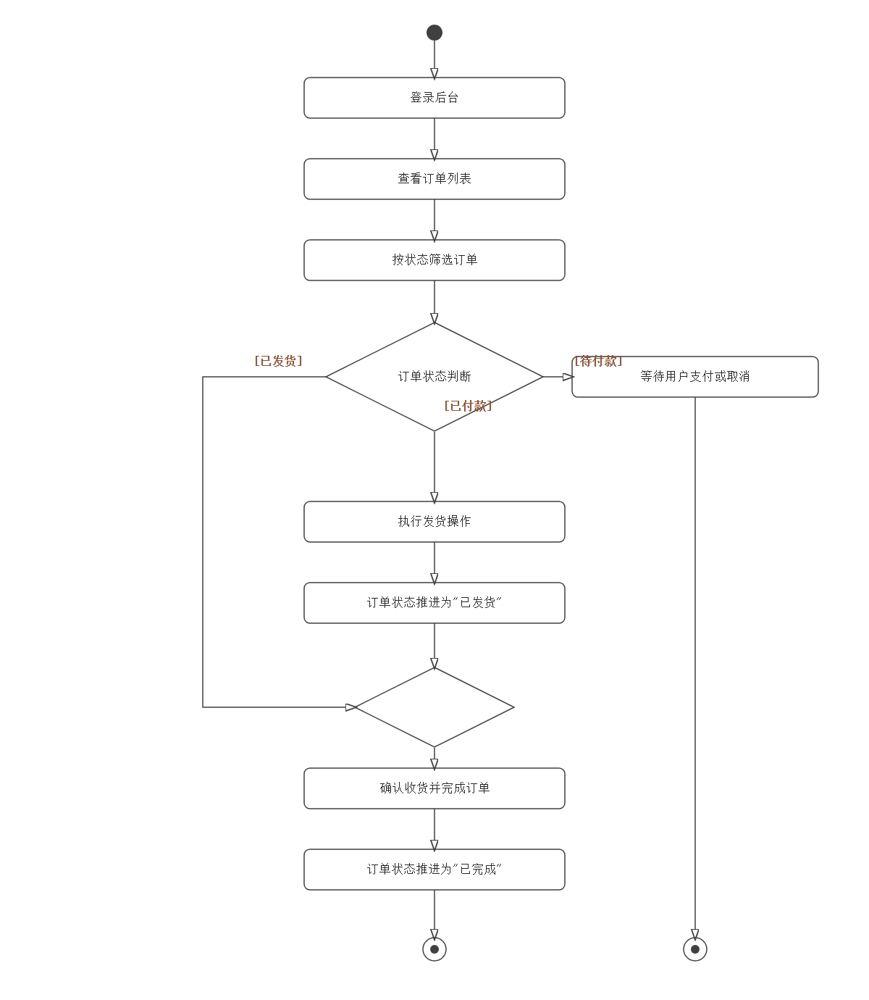
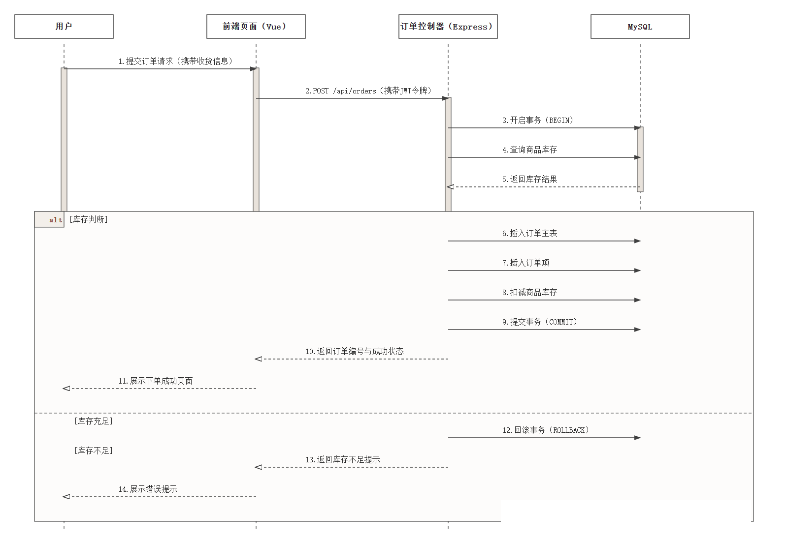
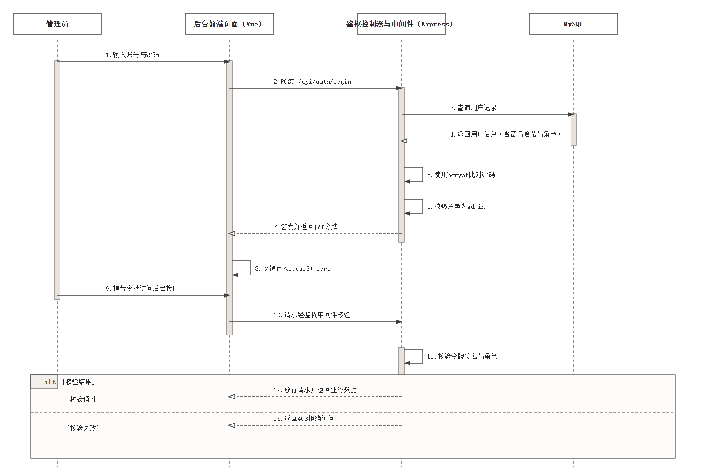
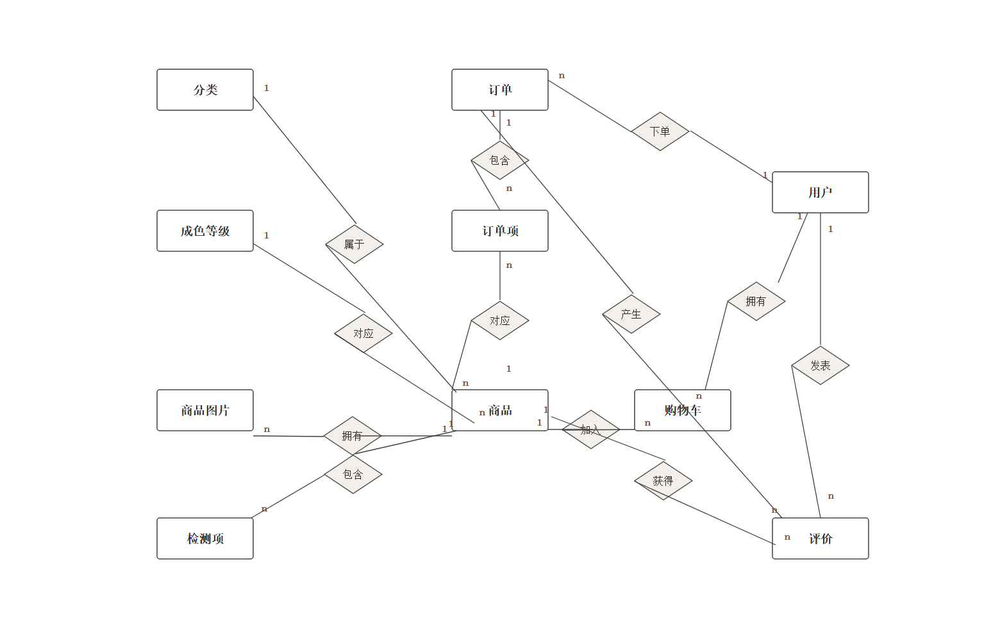
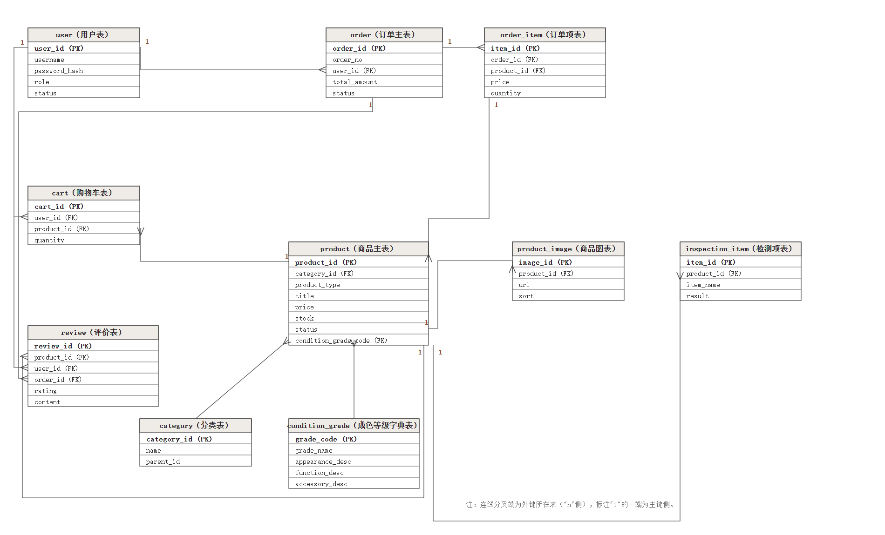

# 第3章　系统分析与设计

本章按照 Garrett 用户体验五层模型的要求，从战略层与范围层出发，首先通过问卷调查、用户访谈与对比分析刻画目标用户需求，明确系统功能范围；随后采用 UML 对系统进行建模，通过用例图描述用户与系统的交互边界，通过活动图刻画核心业务流程，通过顺序图描述关键交互的消息时序；最后按照概念结构设计、逻辑结构设计与物理结构设计三个层次完成数据库设计，为第 4 章系统实现提供依据。

## 3.1 用户调研

### 3.1.1 调研目的与方法

用户调研是系统需求分析的基础环节，对应五层模型中的战略层与范围层：战略层需要明确"目标用户是谁、用户需要什么"，范围层需要将用户需求转化为具体的功能范围。本课题面向胶片摄影爱好者群体，该群体规模相对小众但需求特征鲜明，仅凭文献归纳难以准确刻画其购买决策过程，因此有必要开展面向真实目标用户的调研。

调研综合采用三种方法。一是问卷调查法，面向胶片摄影爱好者群体发放结构化问卷，定量收集用户画像、器材使用习惯、购物偏好与现有平台痛点，为功能范围与优先级确定提供数据支撑；二是访谈法，选取资深玩家、入门新手与器材经营者三类典型对象开展深度访谈，定性挖掘问卷难以覆盖的决策细节与信任诉求；三是对比分析法，选取主流综合电商平台与同类二手器材交易站点，从商品信息组织、筛选交互、交易流程与视觉风格四个维度进行横向对比，提炼可借鉴的设计要点。三种方法互为补充，共同支撑目标用户需求刻画。

### 3.1.2 调研实施与样本

问卷调研于 2025 年 11 月至 12 月开展，通过胶片摄影爱好者 QQ 群与微信群、豆瓣胶片摄影小组、高校摄影协会等渠道发放问卷 100 份，回收 94 份，剔除答题时间过短或答案前后矛盾的无效问卷 7 份，最终获得有效问卷 87 份，有效率为 92.6%。深度访谈选取 8 名典型对象，包括 3 名拥有多台胶片相机且二手交易经验丰富的资深玩家、3 名接触胶片摄影不足两年的入门新手以及 2 名经营二手影像器材的店主，每人访谈时长约 30 至 45 分钟。对比分析选取闲鱼、淘宝与京东三家综合平台，以及以经营二手相机为主的海外垂直站点 Kamera Store 作为参照对象。调研实施概况见表 3.1。

**表3.1 调研实施概况**

| 调研方式 | 调研对象与渠道 | 实施规模 | 回收情况 |
| --- | --- | --- | --- |
| 问卷调研 | 胶片摄影爱好者（QQ/微信群、豆瓣小组、高校摄影协会） | 发放 100 份 | 回收 94 份，有效 87 份，有效率 92.6% |
| 深度访谈 | 资深玩家 3 名、入门新手 3 名、器材店主 2 名 | 8 人，人均 30~45 分钟 | 形成访谈记录 8 份 |
| 对比分析 | 闲鱼、淘宝、京东、Kamera Store | 4 个平台/站点 | 形成对比分析要点 4 类 |

### 3.1.3 调研结果分析

（1）样本画像。有效问卷样本中，18 至 25 岁受访者占 46%，26 至 35 岁占 31%，36 岁及以上占 23%；在校学生占 38%，职场人士占 41%，自由职业及其他占 21%。器材持有方面，72% 的受访者拥有胶片相机，其中 54% 处于经常使用状态，18% 为收藏或偶尔使用；其余 28% 的受访者尚未购入胶片相机但有明确购买意愿。调研样本以年轻群体为主、购买意愿明确，与胶片摄影复兴的宏观背景相吻合，说明目标用户群体真实存在且规模可观。样本画像统计见图 3.1。

（2）现有平台痛点。针对"您在现有平台购买二手影像器材时遇到过哪些问题"这一多选题，87 名受访者中 68 人选择"二手相机成色与功能状态描述不统一"（78.2%），56 人选择"胶卷有效期与储存条件信息不足"（64.4%），52 人选择"品牌、画幅、感光度等多维组合筛选效率低"（59.8%），48 人选择"商品实拍图不足以判断真实状况"（55.2%），41 人选择"交易保障与售后机制模糊"（47.1%），36 人选择"二手价格不透明、比价困难"（41.4%）。前三项痛点与本课题在绪论中提出的问题假设高度一致，证实了面向影像器材建设垂直电商网站的必要性。痛点统计见图 3.2。

（3）访谈发现。资深玩家普遍表示，购买二手相机时最关心快门状态、快门数与机械部件运转情况，希望平台提供统一的成色口径与逐项检测说明，而不是笼统的"九成新"描述；入门新手则对胶卷的感光度选择、有效期与储存条件存在较多知识盲区，倾向于参考他人评价与结构化信息降低决策风险；器材店主指出，标准化的描述体系能够显著减少售前沟通成本与售后纠纷，对买卖双方都有价值。

（4）对比分析。综合平台在影像器材这一垂直品类上的信息承载能力有限：商品模板以通用字段为主，二手相机的快门、测光、取景器等状态无法结构化呈现；胶卷详情中有效期与储存条件常被忽略；通用筛选器难以支持品牌、画幅、感光度等垂直属性的组合筛选。相比之下，海外垂直站点 Kamera Store 通过统一的成色分级与检测说明增强了商品描述的可信度，其做法值得借鉴。对比分析提炼出四点设计启示：建立统一的成色分级字典、将检测结果结构化为逐项清单、按品类扩展垂直属性字段、以复古视觉风格塑造差异化品牌形象。

### 3.1.4 需求总结与功能范围

综合问卷、访谈与对比分析结果，将用户需求归纳为商品信息标准化、高效检索、交易闭环与信任机制四类需求，并映射为具体的系统功能，需求与功能的对应关系见表 3.2。

**表3.2 用户需求与功能映射表**

| 需求类别 | 用户需求 | 对应系统功能 |
| --- | --- | --- |
| 商品信息标准化 | 二手相机成色与功能状态描述统一 | 成色分级字典、检测项清单、快门状态与器材来源结构化展示 |
| 商品信息标准化 | 胶卷有效期与储存条件展示 | 胶卷垂直属性字段（感光度、有效期、储存条件） |
| 商品信息标准化 | 多角度实拍图辅助判断商品状况 | 商品多图上传与轮播展示 |
| 高效检索 | 关键词搜索与多维组合筛选 | 搜索匹配标题/品牌/型号；按品类提供品牌、画幅、感光度、成色、价格区间等组合筛选 |
| 交易闭环 | 在线选品、下单与支付 | 购物车、结算下单、模拟支付、订单管理 |
| 信任机制 | 参考真实买家评价 | 已完成订单评价与详情页评价展示 |
| 安全与运营 | 账号安全与后台运营管理 | 注册登录、JWT 鉴权；后台商品、分类、订单、用户管理 |

据此确定系统功能范围：前台面向普通用户，实现注册登录、分类浏览、关键词搜索与多维组合筛选、商品详情、购物车、结算与模拟支付、订单管理、商品评价八项功能；后台面向管理员，实现商品管理（含垂直属性录入、检测项维护与图片上传）、分类管理、订单管理（含发货）与用户管理四项功能。上述功能范围构成 3.2 节 UML 建模的直接输入。

## 3.2 系统 UML 建模

UML（统一建模语言）以图形化方式描述系统的静态结构与动态行为。本节采用用例图、活动图与顺序图三类模型对"旧光集"系统进行建模：用例图界定系统边界与功能范围，活动图刻画核心业务流程，顺序图描述关键交互中对象之间的消息时序。

### 3.2.1 参与者识别

系统存在两类参与者。普通用户是前台功能的直接使用者，包括未注册的游客与注册用户：游客可以浏览商品、搜索与筛选，加入购物车、结算下单等操作需要登录后完成。管理员是后台功能的操作者，负责商品、分类、订单与用户数据的日常维护，其身份由账号角色字段区分，通过 JWT 令牌与路由守卫实现权限隔离。

### 3.2.2 用例图

前台用例围绕"找得到、看得清、买得放心"的用户旅程组织。用户登录后可进行商品分类浏览、关键词搜索与多维组合筛选，查看按品类差异化渲染的商品详情；随后将商品加入购物车并调整数量，提交结算订单，通过模拟支付完成付款；订单支付后可在"我的订单"中查看订单状态与详情，对已完成订单的商品进行评分与文字评价。前台用户用例图见图 3.3。

后台用例围绕商品、分类、订单与用户四类资源的管理展开。管理员登录后维护商品数据，新增商品时先选择品类，系统按品类动态加载对应垂直属性表单，二手相机还需维护成色等级、快门状态、器材来源与检测项清单并上传多角度实拍图；对商品执行上下架、编辑与删除操作；维护分类树；查看订单列表与详情，对已付款订单执行发货操作；查看用户列表，必要时禁用或启用普通用户账号。后台管理员用例图见图 3.4。

### 3.2.3 活动图

购物下单是系统最核心的业务流程，涉及购物车、库存校验、订单创建与支付多个环节。用户从浏览或搜索开始，查看商品详情后决定是否加入购物车，随后提交订单并填写收货信息；系统校验商品库存，库存不足时提示用户并终止流程，库存充足时在数据库事务中创建订单、生成订单项并扣减库存，任一步骤失败则整体回滚；订单创建成功后进入待付款状态，用户执行模拟支付后订单转为已付款，流程结束。用户购物下单活动图见图 3.5。

订单处理活动图刻画管理员侧的订单状态流转。管理员登录后台后按状态筛选订单列表，对待付款订单等待用户支付或取消；对已付款订单执行发货操作，订单状态推进为已发货；用户确认收货后订单状态推进为已完成，整个流转遵循"待付款—已付款—已发货—已完成"的状态机设计。管理员订单处理活动图见图 3.6。

### 3.2.4 顺序图

用户下单顺序图描述从前端页面到后端控制器再到数据库的完整消息时序。用户在前端提交订单请求后，前端携带 JWT 令牌调用订单接口；控制器校验身份与参数后开启数据库事务，依次查询库存、插入订单主表、插入订单项并扣减商品库存，全部成功后提交事务并返回订单编号；若库存不足，事务回滚并向用户返回错误提示。该时序设计保证订单创建与库存扣减的原子性，避免超卖。用户下单顺序图见图 3.7。

管理员登录鉴权顺序图描述管理员访问后台接口的鉴权过程。管理员提交账号密码后，后端查询用户记录并使用 bcrypt 比对密码哈希，校验角色字段为 admin 后签发 JWT 令牌；管理员后续请求后台接口时由中间件统一校验令牌与角色，校验通过后放行业务处理，普通用户令牌访问后台接口则返回 403 拒绝。管理员登录鉴权顺序图见图 3.8。

## 3.3 数据库设计

数据库设计是系统设计的关键环节，直接影响数据完整性与业务功能的实现。本节按照概念结构设计、逻辑结构设计与物理结构设计三个层次展开：概念结构设计以 E-R 图描述业务实体及其联系，逻辑结构设计将 E-R 图转换为关系模式并进行规范化处理，物理结构设计在 MySQL 8.0 环境下确定数据表的存储引擎、字段类型、索引与约束。

### 3.3.1 概念结构设计

系统涉及用户、商品与订单三条业务主线。用户实体通过"下单"联系与订单实体关联，通过"拥有"联系与购物车实体关联，通过"发表"联系与评价实体关联；商品实体"属于"分类实体，通过"对应"联系关联成色等级实体（仅二手相机与二手配件），通过"包含"联系关联检测项实体（仅二手相机），通过"拥有"联系关联商品图片实体；订单实体通过"包含"联系关联订单项实体，通过"产生"联系关联评价实体；订单项实体与购物车实体均通过"对应"联系关联商品实体。系统全局 E-R 图见图 3.9。

### 3.3.2 逻辑结构设计

按照 E-R 图向关系模型的转换规则，将各实体及其联系转换为如下关系模式，其中带下划线的属性为主键：

用户：user（user_id，username，password_hash，phone，email，role，avatar，status，created_at）
分类：category（category_id，name，parent_id，sort）
成色等级：condition_grade（grade_code，grade_name，appearance_desc，function_desc，accessory_desc）
商品：product（product_id，category_id，product_type，title，brand，main_image，price，stock，status，created_at，updated_at，model，frame_format，shutter_count，shutter_status，condition_grade_code，source，detect_summary，iso，expiry_date，storage_note，accessory_type，compatible_model，is_new）
检测项：inspection_item（item_id，product_id，item_name，result，note）
商品图片：product_image（image_id，product_id，url，sort）
购物车：cart（cart_id，user_id，product_id，quantity）
订单：order（order_id，order_no，user_id，total_amount，status，receiver_name，receiver_phone，receiver_address，created_at，paid_at）
订单项：order_item（item_id，order_id，product_id，price，quantity）
评价：review（review_id，product_id，user_id，order_id，rating，content，created_at）

在关系规范化方面，各关系模式均满足第三范式，不存在非主属性对候选码的传递依赖。针对本系统的领域特征，有三处设计取舍需要说明。其一，商品关系模式采用单表承载方案，将二手相机、胶卷与配件三类商品的垂直属性以可空字段的形式并入商品主表，非对应品类的字段一律置空，由 product_type 字段控制前后端对必填项与展示项的判断。与为每类商品单独建立扩展表的方案相比，单表方案查询无需多表连接，表结构简单直观，更适合本课题的体量；其代价是表内存在较多空值，但通过品类前缀的字段命名与程序侧约束可以得到有效控制。其二，订单项关系模式存储成交单价快照，避免商品价格变动影响历史订单数据的准确性；其商品外键允许置空，保证商品删除后历史订单记录仍然完整。其三，评价关系模式通过订单外键关联订单，从数据层面约束只有完成订单交易的用户才能发表评价，维护评价的可信度。

二手相机成色分级是商品信息标准化的核心设计产出。全站统一采用五档成色等级，每一档从外观、功能与配件三个维度给出明确描述，前台展示时以等级标签呈现，替代"九成新"等笼统表述。成色分级对照见表 3.3。

**表3.3 成色分级对照表**

| 等级 | 外观 | 功能 | 配件 |
| --- | --- | --- | --- |
| 99 新 | 近乎全新，无明显使用痕迹 | 全部功能正常 | 原包装、说明书齐全 |
| 95 新 | 极轻微使用痕迹，无明显划痕 | 全部功能正常 | 主要配件齐全 |
| 9 新 | 正常使用痕迹，轻微划痕 | 全部功能正常 | 机身与标配镜头 |
| 85 新 | 明显使用痕迹，局部磨损 | 核心功能正常，次要功能不影响使用 | 仅机身 |
| 8 新 | 较多磨损与掉漆 | 快门测光等核心功能正常，可能有小瑕疵 | 仅机身 |

### 3.3.3 物理结构设计

数据库采用 MySQL 8.0，全部数据表使用 InnoDB 存储引擎以支持事务与外键约束，字符集统一为 utf8mb4 以完整存储中文与特殊字符。数据表清单见表 3.4。

**表3.4 数据表清单**

| 序号 | 表名 | 中文名称 | 用途说明 |
| --- | --- | --- | --- |
| 1 | user | 用户表 | 存储注册用户信息与角色、状态 |
| 2 | category | 分类表 | 存储一级分类与子分类结构 |
| 3 | condition_grade | 成色等级字典表 | 全站统一的五档成色口径 |
| 4 | product | 商品主表 | 三类商品的共有字段与垂直属性字段 |
| 5 | inspection_item | 检测项表 | 二手相机的逐项检测结果 |
| 6 | product_image | 商品图表 | 商品多角度实拍图路径 |
| 7 | cart | 购物车表 | 用户购物车项 |
| 8 | order | 订单主表 | 订单信息与状态流转 |
| 9 | order_item | 订单项表 | 订单商品明细与成交单价快照 |
| 10 | review | 评价表 | 商品评分与文字评价 |

核心表设计说明如下。用户表以 user_id 为自增主键，username 建立唯一约束保证登录名不重复，password_hash 存储 bcrypt 哈希值而非明文，role 字段区分 user 与 admin 两类角色，status 字段支持账号禁用。商品主表以 product_id 为自增主键，category_id 外键关联分类表，product_type 枚举 camera、film、accessory 区分商品品类；二手相机垂直属性包括画幅规格、快门数、快门状态、成色等级、器材来源与检测总结，胶卷垂直属性包括感光度、有效期与储存条件，配件垂直属性包括配件类型、适配机型与新旧状态；成色等级通过 condition_grade_code 外键关联字典表，保证全站口径统一。订单主表以 order_id 为自增主键，order_no 建立唯一约束保证订单编号不重复，status 枚举 pending_pay、paid、shipped、completed、cancelled 五种状态支撑订单状态机流转，收货人姓名、电话与地址在订单创建时冗余存储，保证历史订单可追溯。

索引与约束设计方面，商品表在 category_id 以及 product_type 与 status 的组合上建立索引，在 price 上建立索引，支撑分类浏览与多维筛选查询；购物车表对 user_id 与 product_id 建立唯一约束，避免同一商品重复加入；订单表在 user_id 与 status 上建立索引，支撑订单列表与状态筛选；订单项、评价、检测项与商品图片表均在外键列上建立索引，保证关联查询效率。外键约束保证引用完整性，其中检测项表与商品图片表随商品级联删除，订单项表的商品外键在商品删除后置空以保留订单快照。数据库物理关系见图 3.10。

